# Allowance

**A shopping agent for teenagers that pays with the family's PayPal, but only inside rules a parent signs.**

An entry for the PayPal AI Hackathon. Everything here runs against the **PayPal sandbox**. No real money moves.

- Demo video: [`demo/video.mp4`](demo/video.mp4) (under three minutes), narration in [`demo/narration.txt`](demo/narration.txt)
- Devpost text: [`docs/devpost.md`](docs/devpost.md)
- Build notes (what surprised us in PayPal, Channel3 and the models): [`docs/build-log.md`](docs/build-log.md)

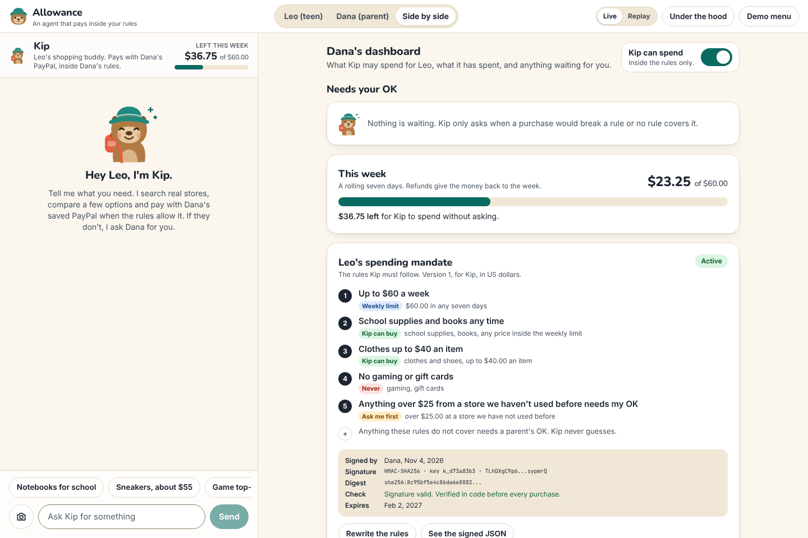

## The problem, and who it is for

A teenager needs to buy things: notebooks, a calculator, sneakers. Today a parent has two bad options.

1. **Hand over the card.** No limits, and no say in what gets bought.
2. **Approve every purchase.** The parent becomes the bottleneck for a pack of pens.

PayPal's pitch for this hackathon is AI that actually transacts, not just recommends. Families cannot use that yet,
because letting an agent pay today means handing it the card. Allowance is the missing layer: **a signed spending
mandate**, an agent that shops across real retailers, and a parent who only gets pinged when it matters.

It is for parents of 13 to 17 year olds who already give an allowance or pay for school things, and for the teens
themselves.

## The aha

The same teen makes three requests in under a minute:

| Leo asks Kip for | What happens | Who decided |
| --- | --- | --- |
| notebooks for school | bought at once with the saved PayPal, no popup, and the receipt says "Paid under rule 2: School supplies and books any time" | code, from the signed mandate |
| sneakers around $55 | Kip does not pay. Dana gets a card with Kip's reasoning and the exact rule it would break ("Clothes up to $40 an item"). One tap, then PayPal captures. | Dana |
| a gaming gift card | declined kindly, with rule 4 quoted. Nothing is searched and nothing is charged. | code, from the signed mandate |

The model proposes. Code checks the rules. A person approves where the rules say so.

## A 60-second tour

| | |
| --- | --- |
| 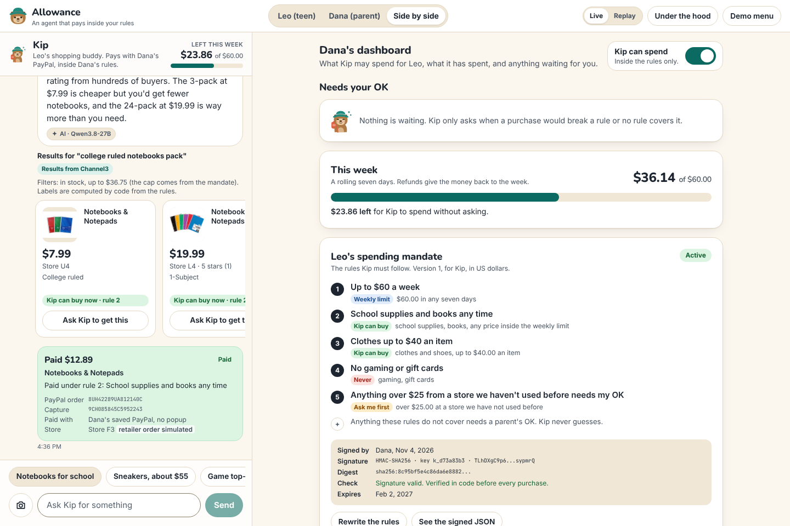 **1. Inside the rules: paid.** Kip searches Channel3 with the mandate's price cap, compares, and pays with the vaulted PayPal. The receipt quotes the rule and shows the PayPal order and capture ids. | 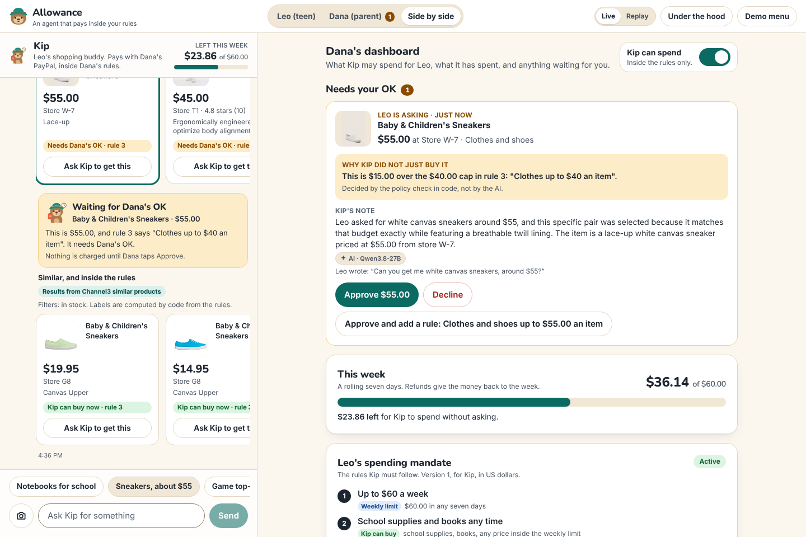 **2. Over a cap: ask.** The approval card shows what Leo asked, Kip's note (AI, tagged with the model), and the rule, which is decided in code. |
| 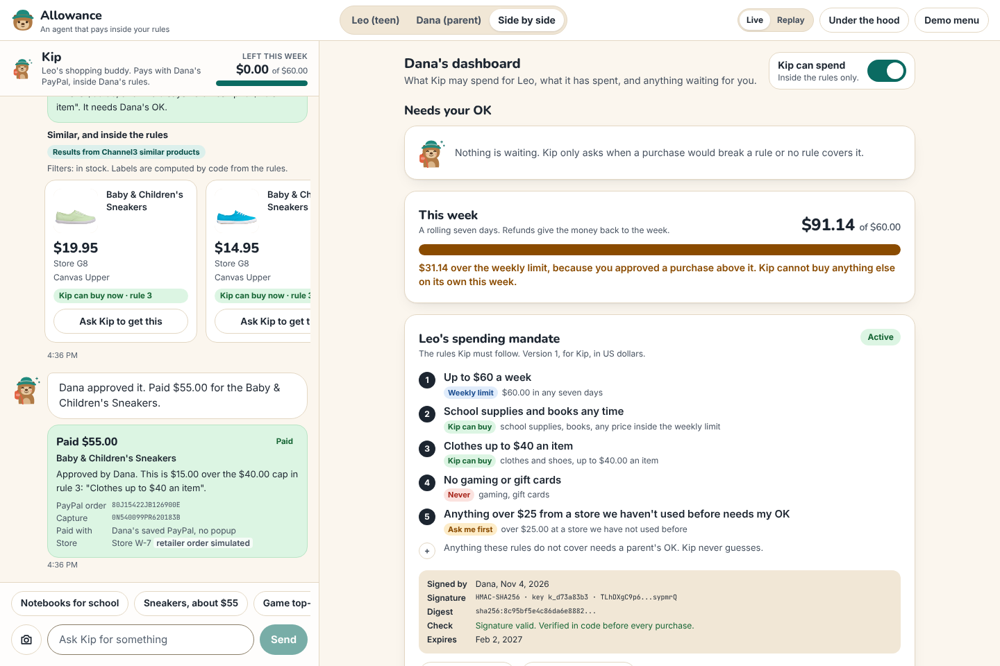 **3. One tap.** Dana approves and the saved PayPal is charged. "Approve and add a rule" also signs a new mandate version. | 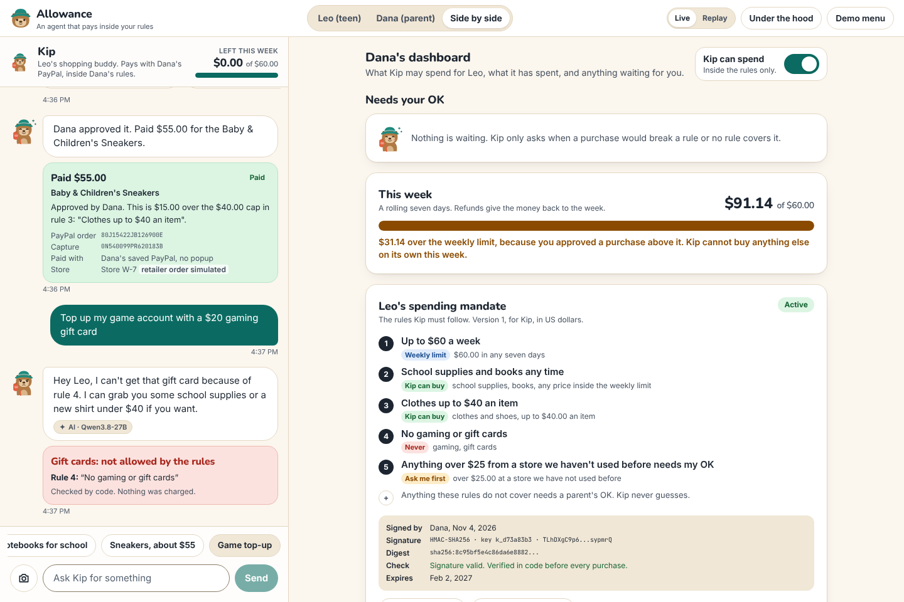 **4. Blocked.** A request for a blocked category is refused by the policy code before any search. |
| 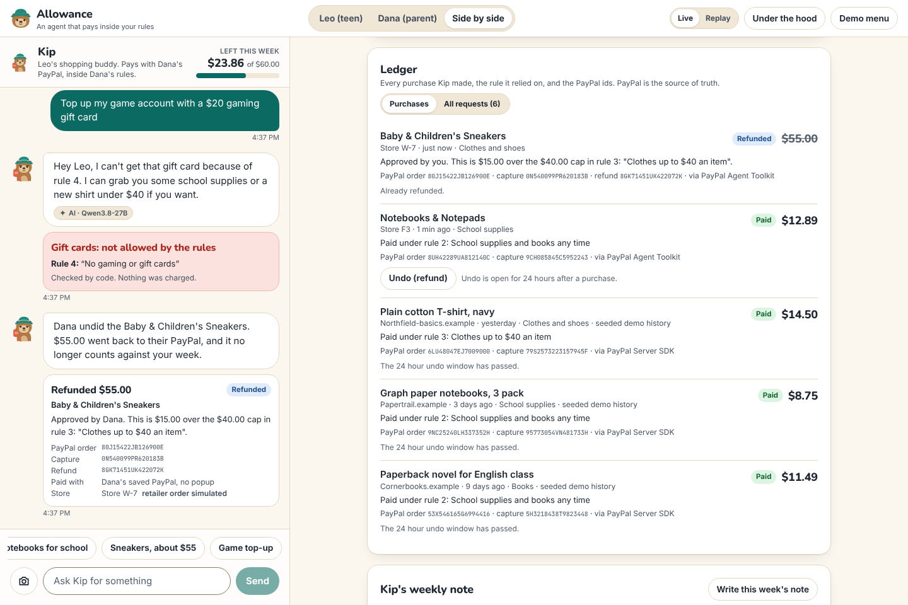 **5. Undo.** For 24 hours a parent can undo a purchase, which is a PayPal refund. The money returns to the week's budget. | 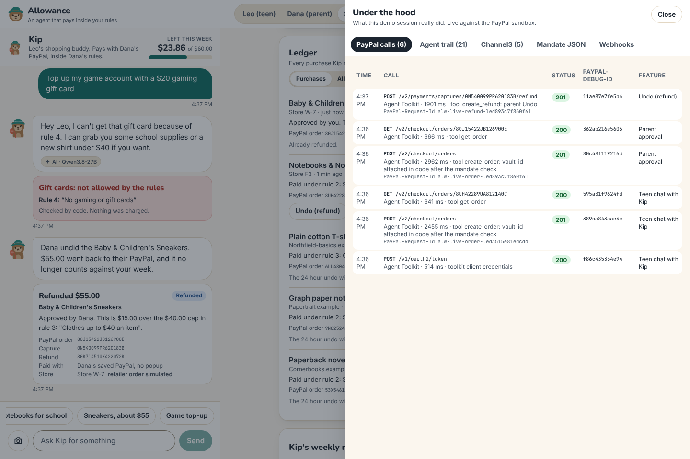 **6. Under the hood.** Every PayPal call the session made: method, path, status, `PayPal-Debug-Id`, the feature that triggered it. |
| 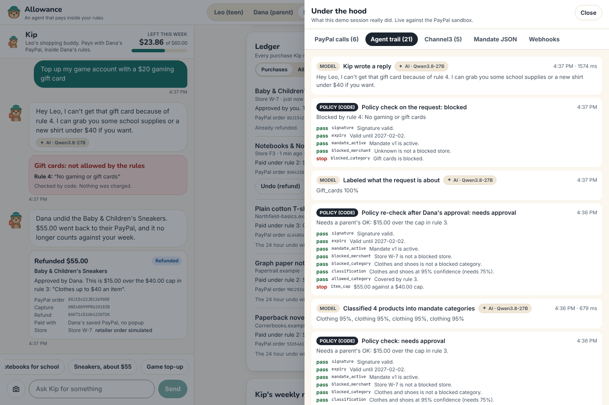 **7. The reasoning trail.** Each model turn, tool call and policy check, with every check that passed or stopped. | 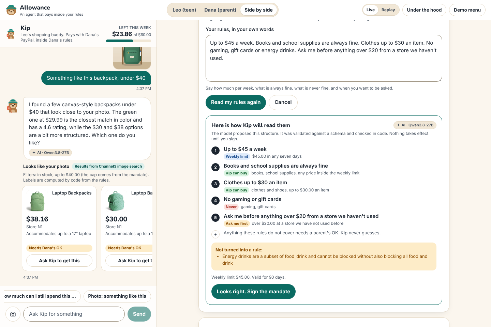 **8. Rules in plain English.** The model proposes a structured mandate, a schema validates it, the parent signs. |
| 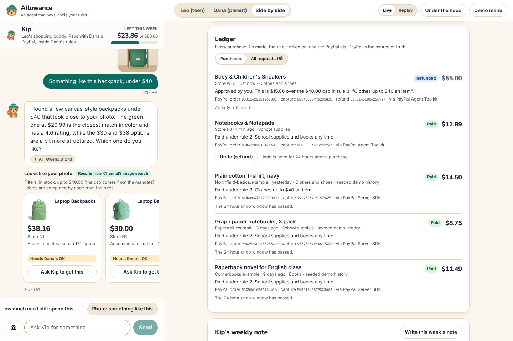 **9. "Something like this."** A photo goes to Channel3 image search with the mandate's price cap. | 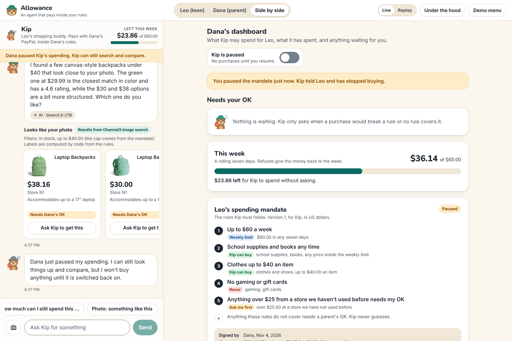 **10. Pause.** One switch stops Kip on the next policy check. Kip tells Leo. |

More in [`docs/screenshots/`](docs/screenshots): the signed mandate JSON, the weekly note, Replay mode and the teen view on a phone.
The screenshots and the video were taken in the app's recording mode (`?safe=1`), which masks store domains and removes
brand names from product titles so that no other company's marks are in frame. The live app shows the real names.

## How it works

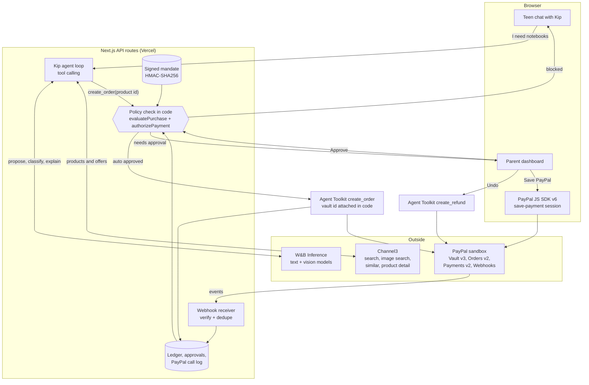

**The trust boundary.** The model can search, compare and ask to buy. It cannot pay.

- Kip's `create_order` tool takes a product id and a sentence of reasoning. Nothing else. No amount, no store, no
  payment detail.
- The wrapper (`lib/agent/guard.ts`) requires the product to be one Channel3 returned in this session, re-reads its
  price from Channel3 product detail, classifies it, and runs `evaluatePurchase()` (`lib/mandate/policy.ts`), which is
  plain code with 85 unit and integration tests around it.
- Only if `authorizePayment()` says yes does the code call the PayPal Agent Toolkit's `create_order`, with arguments
  built by code. The saved PayPal (the vault id) is attached server-side by an interceptor. The model never sees it.

### The mandate

The parent's rules become a small signed JSON document: weekly budget, allowed categories with per-item caps, blocked
categories and stores, approval thresholds, trusted stores, expiry. It is signed with HMAC-SHA256 over its canonical
JSON using `MANDATE_SIGNING_SECRET` (`lib/mandate/sign.ts`). The signature is verified before every purchase, so
changing a cap or the budget in storage makes Kip stop. The card shows the version, key id, signature and digest, and
the full JSON is in the Under the hood drawer.

This is the "intent mandate" idea from agent payment protocols such as AP2: a standing instruction from the user that
the agent must be able to present for every purchase. **Allowance does not implement AP2 and does not claim AP2
compliance.** The signature here is made by the app's server key, not by a credential the parent holds.

### Merchant of record, said honestly

In this prototype, Allowance charges the family's saved PayPal through **its own sandbox merchant account**. It then
hands off to the retailer through Channel3's buy link. **The retailer order step is simulated, and labeled as
simulated** on every receipt. In production this is where PayPal's agentic commerce services would let the agent pay
retailers directly.

## PayPal: every API and feature, and where it lives

Server calls use `@paypal/paypal-server-sdk` 2.5 wherever it covers the API and plain REST with one OAuth token helper
where it does not. The agent's money tools come from `@paypal/agent-toolkit` 1.11. Base URL
`https://api-m.sandbox.paypal.com`. Every POST that creates or changes something carries a `PayPal-Request-Id` derived
from the thing being paid or refunded, so a retry cannot repeat it.

| Product | Endpoint | What it does here | Code |
| --- | --- | --- | --- |
| Vault v3 | `POST /v3/vault/setup-tokens` | starts "save my PayPal" (usage type MERCHANT, on payer approval) | `lib/paypal/vault.ts` `createSetupToken`, `app/api/paypal/vault/setup-token/route.ts`, `scripts/seed.ts` |
| Vault v3 | `POST /v3/vault/payment-tokens` | exchanges the approved setup token for the payment token Kip pays with | `lib/paypal/vault.ts` `createPaymentToken`, `app/api/paypal/vault/payment-token/route.ts` |
| Vault v3 | `GET /v3/vault/payment-tokens/{id}` | `pnpm seed` checks the saved token still exists | `lib/paypal/vault.ts` `getPaymentToken` |
| JS SDK v6 | `web-sdk/v6/core`, `createInstance({ clientToken })`, `findEligibleMethods({ paymentFlow: "VAULT_WITHOUT_PAYMENT" })`, `createPayPalSavePaymentSession`, `<paypal-button>` | the parent approves saving in PayPal's own window | `components/PayPalSaveButton.tsx` |
| OAuth | `POST /v1/oauth2/token` with `response_type=client_token` | browser-safe client token that v6 needs for vault flows | `lib/paypal/vault.ts` `createClientToken`, `app/api/paypal/client-token/route.ts` |
| Orders v2 | `POST /v2/checkout/orders` with `payment_source.paypal.vault_id` | charges the saved PayPal with no popup. Through the Agent Toolkit's `create_order` in the app, through the Server SDK in `pnpm seed`. | `lib/paypal/orders.ts` `chargeVaultViaToolkit`, `chargeVaultViaSdk`; `lib/agent/guard.ts` `pay` |
| Orders v2 | `POST /v2/checkout/orders/{id}/capture` | only if a create ever comes back approved but not captured (see note) | `lib/paypal/orders.ts` `captureOrder` |
| Orders v2 | `GET /v2/checkout/orders/{id}` | confirms the order before anyone is told it is paid (Agent Toolkit `get_order`) | `lib/paypal/orders.ts` `getOrder` |
| Payments v2 | `POST /v2/payments/captures/{id}/refund` | the parent's Undo (Agent Toolkit `create_refund`) | `lib/paypal/orders.ts` `refundCapture`, `lib/actions.ts` `undoPurchase` |
| Payments v2 | `GET /v2/payments/captures/{id}` | re-reads money state so screens are right without webhooks | `lib/paypal/orders.ts` `getCapture`, `lib/actions.ts` `syncFromPayPal` |
| Webhooks | `POST /v1/notifications/verify-webhook-signature` | verifies every delivery against the raw body | `lib/paypal/webhooks.ts` `verifyWebhookSignature`, `app/api/paypal/webhook/route.ts` |
| Webhooks | `GET`, `POST`, `PATCH /v1/notifications/webhooks` | `pnpm paypal:webhook <url>` registers the URL and event types | `lib/paypal/webhooks.ts` `registerWebhook`, `scripts/paypal-webhook.ts` |
| OAuth | `POST /v1/oauth2/token` (client credentials) | cached token for the REST calls above | `lib/paypal/core.ts` `accessToken` |

Webhook events handled: `PAYMENT.CAPTURE.COMPLETED`, `PAYMENT.CAPTURE.DENIED`, `PAYMENT.CAPTURE.REFUNDED`,
`PAYMENT.CAPTURE.REVERSED`, `VAULT.PAYMENT-TOKEN.CREATED`, `VAULT.PAYMENT-TOKEN.DELETED`. Handlers are idempotent (the
event id is claimed first). The app never depends on delivery: every money screen also re-reads PayPal.

**Notes for PayPal's judges**

- **Create and capture are one call here.** An order created with intent CAPTURE and a vaulted PayPal as the payment
  source comes back `COMPLETED` with the capture inside. The code handles the other shape too, and re-reads the order.
- **JS SDK v6 covers the save-PayPal flow**, so nothing in this app uses v5.
- **How the Agent Toolkit is wrapped.** `lib/paypal/toolkit.ts` enables only `create_order`, `get_order` and
  `create_refund`. They are never given to the model. Application code calls them after the mandate check, and an axios
  interceptor adds the vaulted payment source, the `PayPal-Request-Id` and captures the `PayPal-Debug-Id`. The toolkit's
  own `create_order` schema has no field for a vault id, which is exactly why the model cannot supply one.
- **Under the hood** lists each call with how it was made (Agent Toolkit, Server SDK or REST).
- The full contract sheet (durable writes, unknown outcomes, optional fields, error mapping) is in
  [`paypal-plan.md`](paypal-plan.md).

## The AI: which models, for what, and the guardrails

All models run on W&B Inference through the OpenAI SDK with tool calling, server-side only, with four retries, a 60
second timeout and a fallback model. Every AI-written output in the UI carries a small **AI** tag naming the model.

| Job | Model | Code | What keeps it safe |
| --- | --- | --- | --- |
| Kip's agent loop: understand the request, search, compare, explain the pick | `Qwen/Qwen3.8-27B` | `lib/agent/kip.ts` | can only call five tools; a shopping request must use a tool; one purchase per message |
| Plain-English rules to a mandate draft | `Qwen/Qwen3.8-27B` | `lib/ai/mandate-parser.ts` | Zod schema, then `normalizeDraft()` (one budget, nothing both allowed and blocked); nothing takes effect until the parent signs |
| Classify each product into a mandate category, with confidence | `Qwen/Qwen3.8-27B` | `lib/ai/classify.ts` | below 75% confidence the purchase goes to the parent; a skipped product gets confidence 0 |
| Label what a request is about (screening) | `Qwen/Qwen3.8-27B` | `lib/ai/classify.ts`, `lib/agent/kip.ts` | runs alongside the first model turn; a blocked category is refused in code whatever tool the model picks |
| Kip's note to the parent on an approval card | `Qwen/Qwen3.8-27B` | `lib/agent/guard.ts` | the rule and the amounts on the card come from code, not from this text |
| Weekly note for the parent | `Qwen/Qwen3.8-27B` | `lib/ai/summary.ts` | every number is computed from the ledger in code and shown next to the text |
| Describe a photo for image search | `google/gemma-4-31B-it` | `lib/agent/kip.ts` | only adds a phrase of context; Channel3 does the matching |
| Fallback when the main model keeps failing | `zai-org/GLM-5.3-Flash` | `lib/ai/llm.ts` | larger token budget, because it always reasons first |

Guardrails that do not depend on the model:

- **Money decisions are deterministic.** `evaluatePurchase()` checks, in order: mandate present, signature valid, not
  expired, not paused, store not blocked, category not blocked, classifier confident enough, category covered by a rule,
  per-item cap, approval rules (price and new store), weekly budget. The first failing check decides the outcome.
- **The amount is never model text.** It is the Channel3 offer price, re-read at purchase time, from the same store the
  teen was shown, new and in stock only.
- **Unknown product ids are refused**, so a hallucinated id cannot be bought.
- **A person approves** whenever the outcome is "needs approval", and an approval only covers that product at that price
  or less.
- AI and money routes are rate limited per IP (`lib/http.ts`).
- Each agent step is logged and shown in the reasoning trail.

## Sponsor tools

### Channel3

Channel3 is Kip's catalog. It is called in every shopping turn, and the UI marks its results with "Results from
Channel3". Four uses, each visible in the product (`lib/channel3/client.ts`, package `@channel3/sdk`):

| Use | Call | Where it shows |
| --- | --- | --- |
| Text search with filters from the mandate | `products.search` with `price.max_price` from the budget and caps, `availability: ["InStock"]`, `conditions: ["new"]` | product cards in the chat, with the filters spelled out |
| Image search | `products.searchByImage` with a base64 photo and the same price cap | "Photo: something like this" in the chat |
| Similar products | `products.findSimilar` capped at what the rules allow | "Similar, and inside the rules" under an approval request |
| Product detail | `products.retrieve`: offers across retailers and buy links | re-checked right before paying; the buy link is the simulated retailer handoff |

Responses are cached. If Channel3 is slow, failing or out of credits, the last good response for the same request is
served and labeled "cached result".

### APIMatic

- All Vault calls, the seed purchases and the capture lookups go through **`@paypal/paypal-server-sdk`**, which
  APIMatic generates.
- APIMatic's **PayPal Context Plugin** skills for TypeScript are in `.claude/skills/`. We used the plugin's integration
  workflow: the contract sheet in [`paypal-plan.md`](paypal-plan.md) with its tables for durable writes (claim, call,
  record), unknown outcomes, optional request fields and "when the API says no". That review is where the tests in
  `tests/payments.test.ts` and the single error ladder in `lib/http.ts` came from.
- Two honest notes. The plugin documents APIMatic's newer `paypal` package rather than `@paypal/paypal-server-sdk`, so
  we followed its method and looked every SDK fact up in the installed SDK source. And the sheet was written up after
  the sandbox smoke tests and the first version of the PayPal layer, not strictly before any code as the plugin asks.

## Under the hood, and Replay mode

- **Under the hood** (top right) lists what the current session really did: PayPal calls, the agent trail with each
  policy check, Channel3 calls, the signed mandate JSON and webhooks.
- **Replay** (top right, clearly bannered) runs the same application code, but PayPal, Channel3 and the model answer
  from recordings of a real sandbox run (`fixtures/replay/`, made by `pnpm replay:record`). The policy check, ledger and
  UI still run for real. It exists for when the sandbox or the model is down. **Live is the default.**
- Each browser gets its own demo family, cloned from the seeded template, so one visitor's purchases never use up
  another visitor's weekly budget. "Demo menu" has "Start over" and "Start from an empty family".

## Run it locally

Requirements: Node 22, pnpm 10.

1. **Sandbox app.** In the PayPal Developer Dashboard create a sandbox REST app with **Vault** enabled, and a sandbox
   Personal (buyer) account. That buyer is "Dana's PayPal".
2. **Environment.** Copy `.env.example` to `.env.local` and fill it in. Generate the two local secrets:

   ```bash
   openssl rand -hex 32   # MANDATE_SIGNING_SECRET
   openssl rand -hex 24   # DEMO_ADMIN_TOKEN
   ```

3. **Install and seed.**

   ```bash
   pnpm install
   pnpm seed
   ```

   `pnpm seed` saves the buyer's PayPal once (it approves in PayPal's window with Playwright and the sandbox buyer
   login) and makes three small sandbox purchases so the ledger is not empty. It is safe to re-run.

4. **Run.**

   ```bash
   pnpm dev
   ```

   Open http://localhost:3000. Wide screens show the teen and the parent side by side; `/teen` and `/parent` open one
   role each.

Other commands:

| Command | What it does |
| --- | --- |
| `pnpm test` | Vitest: the money rules, the mandate, the PayPal write path, and the whole flow offline from the Replay tapes |
| `pnpm lint`, `pnpm build` | ESLint and the production build |
| `pnpm paypal:webhook <public-url>` | registers `<url>/api/paypal/webhook` for this app's events and prints the webhook id |
| `pnpm replay:record` | re-records the Replay fixtures against the live sandbox |
| `pnpm screenshots` | retakes `docs/screenshots/` from the running app |
| `pnpm a11y` | axe-core scan of ten app states (needs the app running) |
| `pnpm video` | records, renders cards and composes `demo/video.mp4` (needs `ELEVENLABS_API_KEY` and ffmpeg) |
| `curl -X POST <host>/api/admin/reset -H "x-admin-token: $DEMO_ADMIN_TOKEN"` | drops every visitor session so the demo is clean again |

Deploying to Vercel needs a Blob store (`BLOB_READ_WRITE_TOKEN`) for state. See [`docs/needs-user.md`](docs/needs-user.md).

## Sandbox test logins for judges

- **You do not need to log in to try the main flow.** The hosted demo starts with Dana's PayPal already saved and a
  signed mandate. Ask Kip for something, switch to Dana, approve, undo.
- To try the parent setup yourself: Demo menu, "Start from an empty family", then "Save PayPal". PayPal's sandbox window
  opens. Log in with the **sandbox buyer account** given in the Devpost submission's testing instructions.
- The buyer's email and password are deliberately not printed in this repository. They are in `.env.local` as
  `PAYPAL_SANDBOX_BUYER_EMAIL` and `PAYPAL_SANDBOX_BUYER_PASSWORD`.
- This is the PayPal sandbox. Never enter a real PayPal login. No real money moves.

## Tests

`pnpm test` runs 85 tests in about two seconds, with no network and no keys:

- `tests/policy.test.ts`: every outcome of the policy check, the rolling budget, the gate in front of PayPal, undo.
- `tests/mandate.test.ts`: what the model may propose, signing, tamper detection, "approve and add a rule".
- `tests/payments.test.ts`: claim before call, one charge per approval even on a double tap, webhook handling, an unknown outcome is
  re-read with the same request id and never reported as a failure, a declined wallet is not retried.
- `tests/replay.test.ts`: the whole aha, offline: the real agent loop, guard and ledger run against the recorded tapes.

## Accessibility

Built mobile first, against WCAG 2.2 AA.

What was done:

- Every control is a real button, input or link with a visible label or an `aria-label` that starts with the visible
  text. The role switcher and the Live or Replay switch are radio groups, the pause control is a switch, and the Under
  the hood drawer is a modal dialog with a focus trap, Escape to close, and focus returned to the opener.
- One visible focus ring everywhere (3 px, offset, visible on every background). A "Skip to content" link comes first.
- The chat is an `aria-live` log that wraps a real list, Kip's progress is a status region, errors are alerts, and the
  approvals list announces changes politely.
- Money and status are never shown by color alone: every badge has a word.
- Animations stop under `prefers-reduced-motion`.
- Kip's images have text alternatives where they carry meaning and are hidden from assistive technology where they are
  decoration.
- Touch targets are at least 24 by 24 px (the WCAG 2.2 minimum); primary buttons are 44 px high, secondary ones 36.

What was checked:

- `pnpm a11y` runs axe-core (rules tagged WCAG 2.0, 2.1 and 2.2, levels A and AA) against ten states of the running
  app: side by side, after the three requests, each Under the hood tab, the open menu, the empty-family setup, the teen
  and parent views at 360 px, and Kip's page. Result at the time of writing: **no violations**. The first run found
  five kinds of problem (list items under a `log` role, two missing or mismatched names, a stray menu role, one dimmed
  heading), and they were fixed.
- Contrast was computed for every text and background pair in the palette. The lowest text pair is 5.0 to 1 (small
  gray text on the sand color); body text is 14.4 to 1. Form field borders and the off state of the pause switch are
  at least 3.7 to 1 against their surroundings.
- No horizontal scrolling at 360 px wide.

What was not checked: a screen reader pass with a person, and keyboard-only use beyond tabbing through each view.

## Limitations

- **The retailer order is simulated.** Allowance is the merchant of record in the sandbox; no order is placed with the
  retailer. See "Merchant of record" above.
- **No accounts.** A demo family lives in a browser session. Anyone with the session's link can act as the parent. A
  real product needs sign-in and a parent approval bound to the parent's device.
- **The mandate is signed by the server**, which proves it was not altered in storage. It is not a credential the
  parent holds, and it is not AP2.
- **One teen, US dollars, one item per request**, no shipping or tax in the amount, a rolling seven-day budget.
- **Categories come from a model.** Low confidence goes to the parent, but a confident mistake is possible.
- **State is last writer wins across serverless instances.** PayPal ids and idempotent request ids keep money correct.
- **Not verified in the build environment:** Vercel Blob storage, real webhook deliveries, and the save-PayPal window on
  a real domain. These are listed in `docs/needs-user.md`.
- Catalog data is real retail data, so brand names, odd titles and the occasional non-English listing appear.

## What is next

- Pay the retailer directly through PayPal's agentic commerce services, so the simulated step becomes real.
- Parent sign-in with passkeys, push notifications for approvals, and a mandate signed by a key the parent holds.
- More than one teen per family, allowances that roll over, and a savings goal Kip can explain.
- Returns and partial refunds, shipping addresses, and tax in the policy check.

## Repository map

```
app/                 pages (/, /teen, /parent, /kip) and API routes
components/          teen chat, parent dashboard, mandate card, PayPal save button, Under the hood, Kip
lib/mandate/         schema (Zod), signing, the policy check
lib/agent/           Kip's tool loop and the guarded purchase
lib/paypal/          Server SDK and REST plumbing, vault, orders, refunds, webhooks, Agent Toolkit wrapper
lib/channel3/        Channel3 client with caching
lib/ai/              model client, rules to mandate, classification, weekly note
lib/replay/          record and replay of outside calls
fixtures/replay/     recorded sandbox, Channel3 and model responses
scripts/             seed, webhook registration, replay recording, screenshots, video pipeline
tests/               Vitest
docs/                build log, needs-user, Devpost text, credits, screenshots
demo/                video, thumbnail, narration
```

## Credits

See [`docs/CREDITS.md`](docs/CREDITS.md). Kip, the capybara in the bucket hat, is an original character drawn as SVG for
this project. No stock photos, no third-party artwork, no music. This README quotes no statistics.

## License

Code: [AGPL-3.0](LICENSE). The name Allowance and the mascot Kip are reserved: see [`TRADEMARKS.md`](TRADEMARKS.md).
